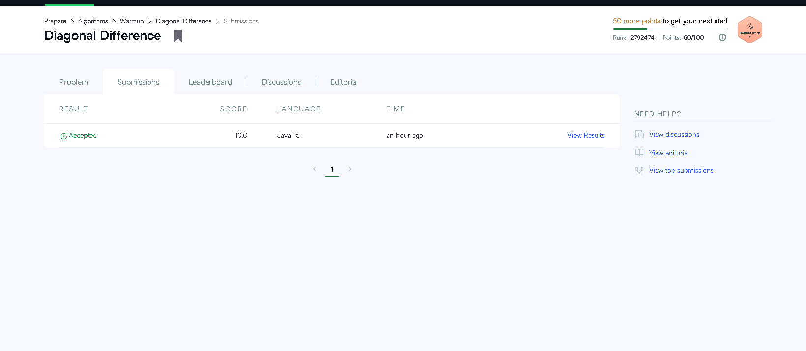
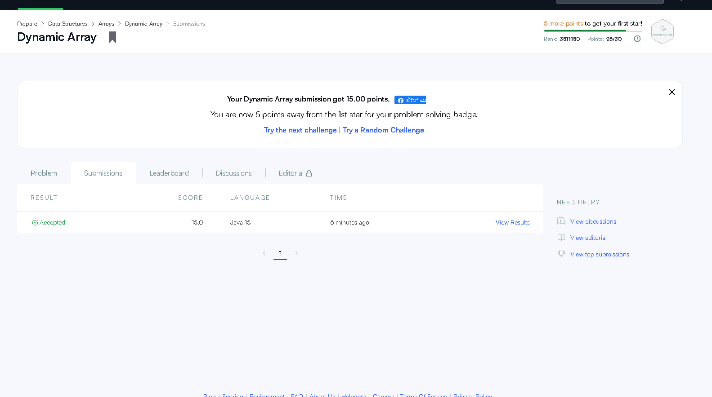
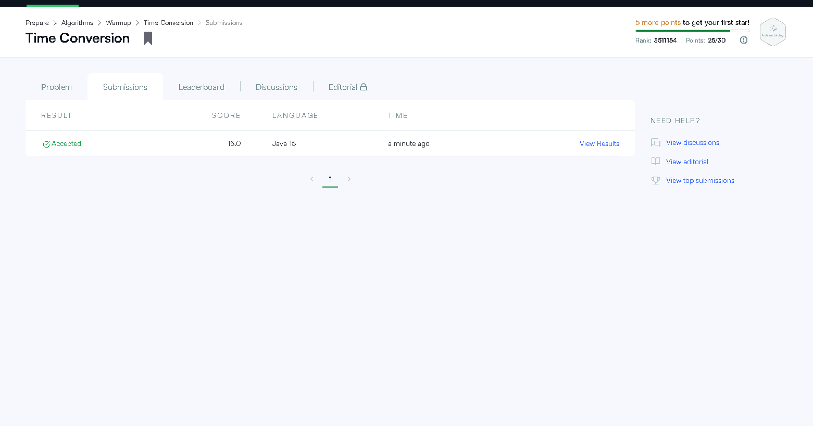
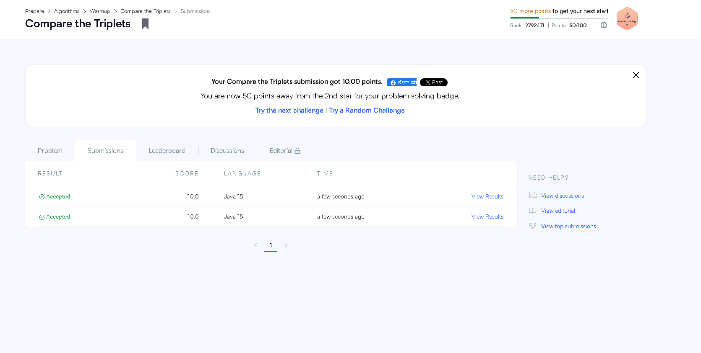
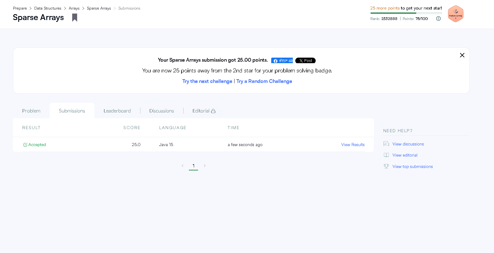

# HackerRank 3rd Semester Portfolio

**HackerRank Profile:** [jrspandana](https://www.hackerrank.com/profile/jrspandana)

## Activity 8: Algorithmic Problem-Solving

**Programming Language:** Java

**Student:** Spandana J R

## Mandatory Problems

1. Diagonal Difference
2. Dynamic Array
3. Time Conversion
4. Compare the Triplets
5. Sparse Arrays

## Complexity Analysis

| Problem | Time | Space |
|---|---|---|
| Diagonal Difference | O(N) | O(1) |
| Dynamic Array | O(N + Q) | O(N) |
| Time Conversion | O(1) | O(1) |
| Compare the Triplets | O(1) | O(1) |
| Sparse Arrays | O(N + Q) | O(N) |

## Accepted Submission Screenshots

### 1. Diagonal Difference

### 2. Dynamic Array

### 3. Time Conversion

### 4. Compare the Triplets

### 5. Sparse Arrays

## HackerRank Badge

